# Widget and Co – Online Store in the Cloud (Proof of Concept)

**Assignment 1: Online Store**
**Built with:** C# and .NET 10, ASP.NET Core Web API, Azure Functions, MediatR, Azure Cosmos DB, Azure SQL, and Azure Table, Blob and Queue Storage.

## 1. The problem and the idea

Widget and Co wants to move its web shop to Azure. Their biggest problem is that the website gets slow when many people shop at the same time. The main reason is that placing an order has to wait until the order is saved in the database.

The scenario also asks for:
- a way to measure how long it takes before an order is shipped,
- user data that another department can also use,
- products in a normal SQL database, with pictures,
- reviews without names, which marketing will look at later.

**The main idea:** placing an order should never have to wait for the database. When a customer orders, the API checks the order, puts it in a queue and answers straight away. An Azure Function then takes the order from the queue and saves it. When it is very busy, orders just wait in the queue for a moment, and the website stays fast. This is called *load levelling*.

For each part of the scenario, I picked the type of storage that fits it best:

| What the scenario asks | How I solved it |
|---|---|
| Ordering is slow when it is busy | Orders go through a queue into **Cosmos DB**, which can grow when needed |
| Save the order date and the shipping date | Both dates are saved on the order; the time between them is the metric |
| User data is shared with another department | Users have their own table in **Table Storage** |
| Products in a SQL database, with pictures | Products are in **Azure SQL**; pictures are in **Blob Storage** |
| Reviews without names, for marketing | Reviews are in **Table Storage**, grouped per product, with no user data |

## 2. How it fits together

All requests come in through the Web API, except shipping, which comes in through an Azure Function. Both send the request to **MediatR**. MediatR runs the right piece of code for that request, and that code talks to the right storage.

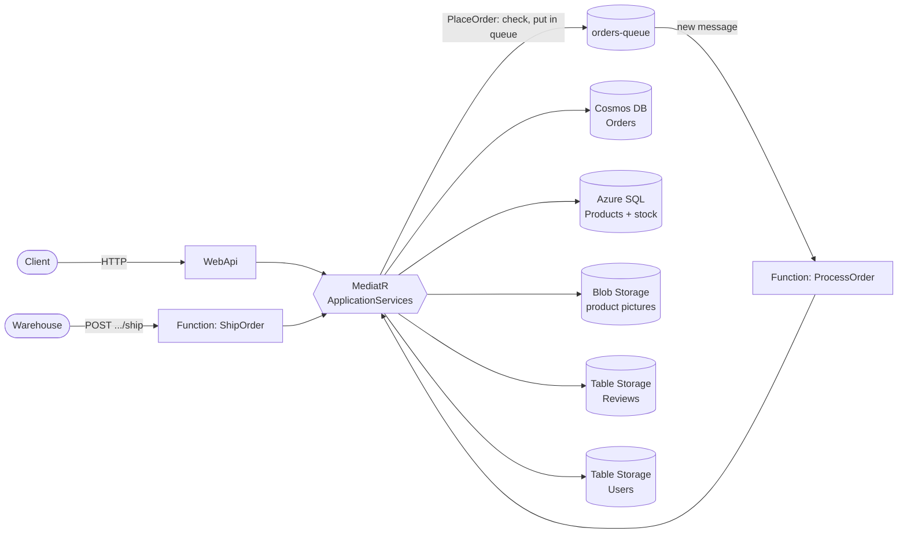

**What happens when someone places an order:**

1. The API gets `POST /orders`. It checks that the customer exists, finds each product in SQL, and checks that there is enough stock. The **price always comes from the database**, never from the request. That way a customer cannot change the price.
2. The order goes into `orders-queue`. The API answers right away with `202 Accepted` and the order number.
3. The `ProcessOrder` Function sees the new message. It lowers the stock in SQL and saves the order in Cosmos DB.
4. When the warehouse ships the order, it calls the `ShipOrder` Function. This saves the shipping date, so the shipping time can be measured.

## 3. The databases

### 3.1 Why five kinds of storage

I did not put everything in one database. Each kind of data goes where it fits best.

**Orders** are the busiest data and the cause of the slow website, so they go into **Cosmos DB**. Cosmos DB can spread data over many servers, can get more power automatically when it is busy, and can read one order very cheaply.

**Products** stay in **Azure SQL**, because the scenario asks for a normal SQL database. Products do not change often and are searched by category and price, which SQL is good at. SQL can also change the stock safely.

**Product pictures** are files, so they go into **Blob Storage**, which is made for files. This keeps the SQL database small and fast. SQL only saves the name of the picture.

**Reviews and users** are simple records that are always found by one key, a product or a user. **Table Storage** is made for this and is very cheap, even with millions of rows.

The **queue** is not a database. It holds orders for a short time between the API and the Function. That is what keeps the website fast when it is busy.

### 3.2 Orders in Cosmos DB

#### The partition key

Cosmos DB splits data into groups called *partitions*. The *partition key* decides which group each order goes into. A good key spreads the orders evenly over the groups, and lets the most common searches look in only one group. The key can never be changed later, so it is the most important choice. I looked at four options:

| Option | Result |
|---|---|
| `orderDate` | **No.** All of today's orders would go into the same group. When it is busy, that one group gets all the work (a *hot partition*). That is exactly the problem we want to fix. |
| `status` | **No.** There are only four statuses, so the orders could never be spread over more than four groups. |
| `id` | **Possible, but not ideal.** The orders are spread well, but "show all orders of this customer" would have to search every group. |
| `customerId` | **Chosen.** There are many customers, so orders are spread evenly. The two most common searches, "show this order" and "show my orders", always know the customer, so they only look in one group. One customer will also never fill up a group (the limit is 20 GB). |

#### How an order is saved

An order is saved as one JSON document. The order lines are saved *inside* the order, not in a separate table. An order and its lines are always read together, so one read gets everything. That read costs only 1 RU. (An *RU*, or Request Unit, is the "price" Cosmos DB charges for each action.)

The product name and price are also copied into the order. So the order always shows the price the customer really paid, even if the product price changes later.

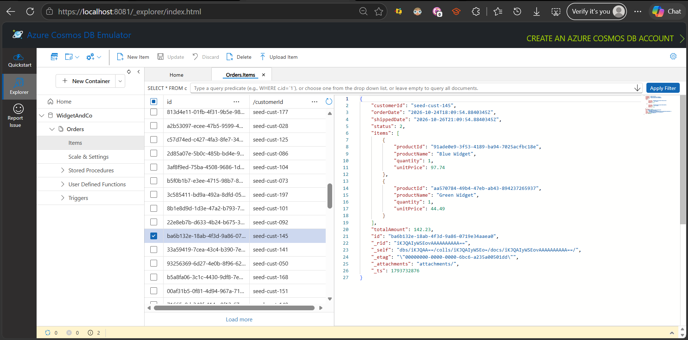
*An order in Cosmos DB, with the order lines inside it*

#### Power and indexing

The container uses **autoscale** between 100 and 1,000 RU/s. When it is quiet, it uses little power and costs little. When it is busy, it gets more power by itself.

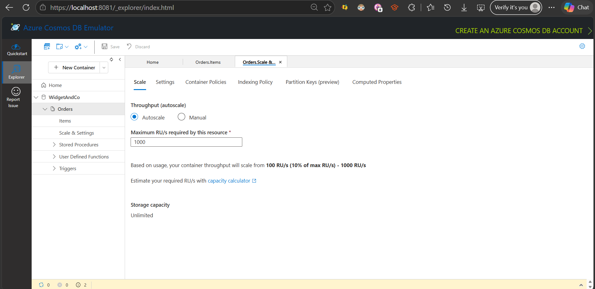
*Autoscale: 100 to 1,000 RU/s*

Cosmos DB normally keeps an index of every field, so it can search fast. But every index makes saving more expensive. Nobody ever searches on the order lines, so I **turned off the index for them**. This makes saving an order cheaper.

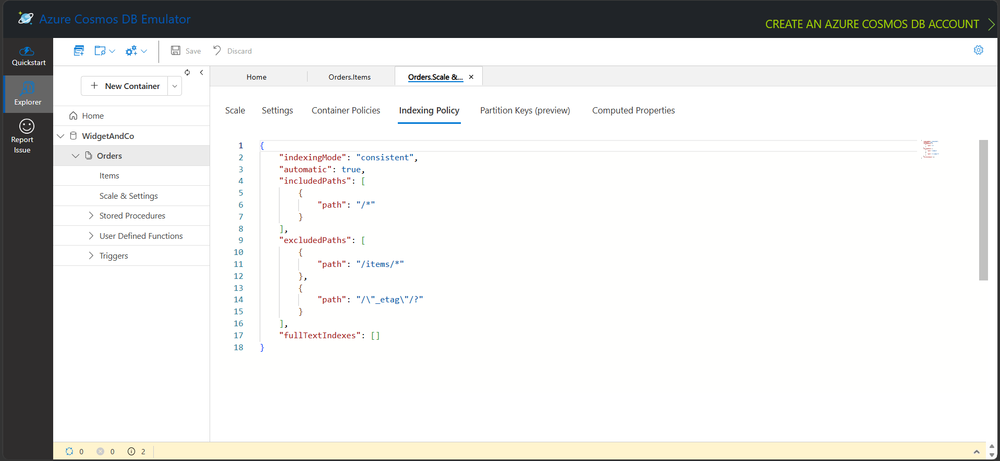
*Indexing policy: the order lines (/items/\*) are not indexed*

Reading uses *eventual* consistency. This is cheaper, and fine for showing orders. Writing uses *session* consistency, so when the code changes an order, it always sees the newest version of it.

#### What it costs

The code logs the RU cost of every Cosmos action. The numbers below come from the running app and from a tool that added 1,000 orders for 200 customers:

| Action | Cost |
|---|---|
| Read one order (by its ID and customer) | 1.00 RU |
| Read all orders of one customer (one group) | 2.90 RU |
| Save a new order | 7.24 RU |
| Change an order when it is shipped | 11.24 RU |
| Search over all customers (484 results) | 15.07 RU |
| The metric search over all customers (139 results) | 6.36 RU |

These numbers show that the partition key works. The normal actions (one order, one customer's orders) look in only one group, so they stay cheap, however many orders the shop gets. Only the metric searches all customers. That is OK, because it does not run often and is not part of placing an order. Saving costs 7 to 11 times more than reading, which is why saving goes through the queue.

When I first filled the database, I sent about 7,000 RU of orders at once to a container that allows 1,000 RU per second. Cosmos DB then refused some of them with **429 Too Many Requests** (called *throttling*). I fixed this by sending fewer orders at the same time and waiting when Cosmos asked me to. After that, 1,000 orders were saved in 15.9 seconds without any refusals. The real app does not have this problem, because the queue already sends orders to Cosmos at a steady speed.

Note: the local emulator keeps everything in one place, so these are starting numbers. In real Azure, searching over all customers gets more expensive as the shop grows. Reading one customer's orders stays the same.

#### The same message twice

Azure Storage Queues promise that every message arrives *at least once* (Queue slides, slide 14). So once in a while, the same order can arrive twice. The EDA slides say to *"ensure idempotency and resilience"* (slide 16): handling the same message twice must give the same result as handling it once.

`ProcessOrder` does this in two steps. First it checks if the order is already saved, which costs only 1 RU. If it is, the message is skipped. But if two copies arrive at exactly the same moment, both can pass that check. That is why new orders are saved with "create" instead of "save or replace". Cosmos DB only accepts the first create. The second one gets **409 Conflict**, and its stock change is undone. So you always end up with one order, and the stock goes down only once.

#### Clicking the order button twice

If a customer clicks the order button twice, two separate requests are sent. To make them one order, the website can send its own order number (one number per checkout page). Both requests then have the same number. The check above saves the order once and lowers the stock once.

### 3.3 Products and stock in Azure SQL

Products are saved with Entity Framework Core, and the database is created with migrations. There is an index on category and price together, because "products in this category within this price range" is the most common search. When the code only reads products, it skips EF Core's change tracking, which makes it faster.

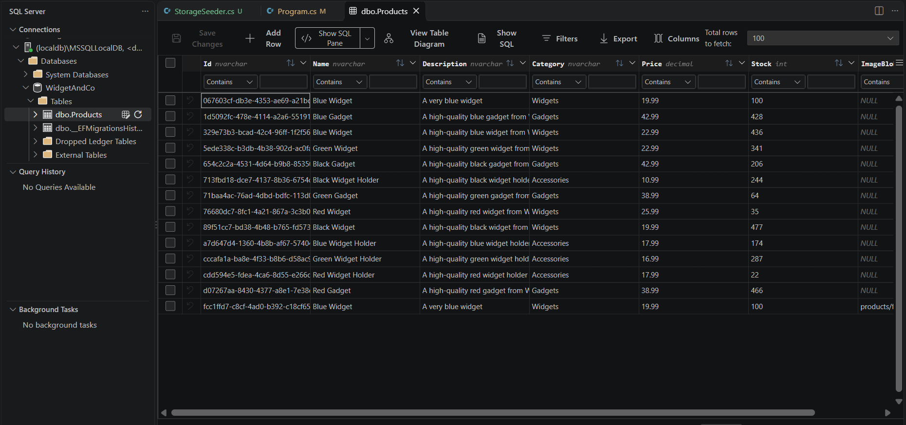
*Products in Azure SQL; only the picture name is saved*

The stock is handled in two places. When someone places an order, the API checks the stock, so the customer sees "not enough stock" right away. The real lowering of the stock happens later, in `ProcessOrder`, with this SQL:

```sql
UPDATE Products SET Stock = Stock - @qty WHERE Id = @id AND Stock >= @qty
```

The `WHERE Stock >= @qty` part means: only lower the stock if there is enough. SQL locks the row while it changes it, so two orders can never both get the last item, even if many Functions run at the same time. If one of the products does not have enough stock, nothing is changed and the order is saved with the status **Rejected**.

Orders and stock are in two different databases, so they cannot be saved in one step. To keep them in sync, the stock change is only made final after the order is saved in Cosmos DB. If saving the order fails, the stock change is undone and the queue tries again later. There is one small gap left: if the very last SQL step fails after the order is saved, the order exists but the stock did not go down. Fixing that completely would need an "outbox" or "saga" pattern, which is too much for this proof of concept.

### 3.4 Product pictures in Blob Storage

The picture container is **private**. If you open a picture's address in a browser, you get an error.

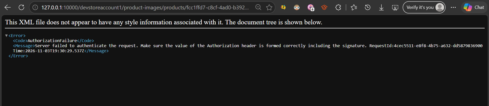
*Without a SAS link: access refused*

When someone asks for a product, the API makes a **SAS link** for its picture. This is a temporary address that only allows reading, and stops working after one hour. With that link, the picture shows normally. This follows the "least privilege" idea from the security slides: nobody gets more access than they need, or for longer than they need.

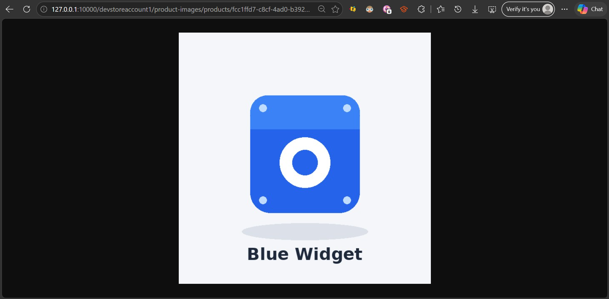
*With a SAS link: the picture is shown*

Every picture gets a unique name in a folder per product, like `products/{productId}/{guid}.jpg`. So two files called `photo.jpg` can never overwrite each other. The file type is saved too, so the browser shows the picture instead of downloading it. The product ID and upload date are saved as extra information (metadata). Only pictures up to 5 MB are allowed. When a product gets a new picture, the old one is deleted.

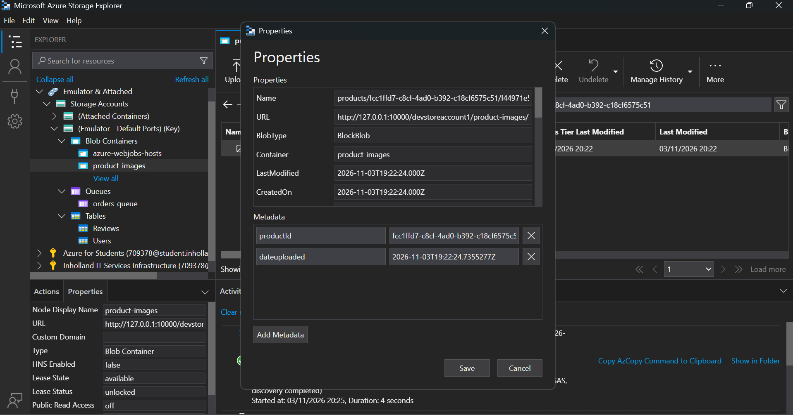
*Picture metadata: productId and dateuploaded*

### 3.5 Reviews and users in Table Storage

Table Storage finds rows with two keys. The **PartitionKey** puts rows together in a group. The **RowKey** names a row inside that group, and also decides the order in which rows come back.

**Reviews** use the product ID as PartitionKey. So all reviews of one product are stored together and can be read in one cheap search. The RowKey is made from the time the review was written, counted backwards. Because of this, the **newest review always comes first**, without any sorting. A random ID is added at the end, so every key is unique. Reviews have no user data at all, because the scenario says they are anonymous.

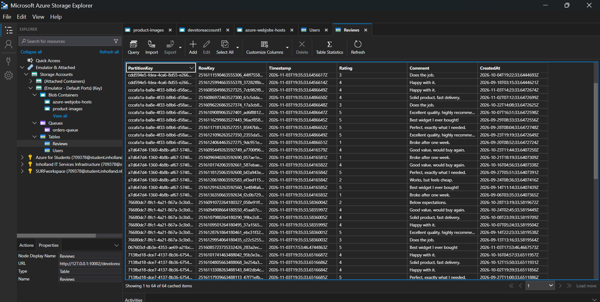
*Reviews: grouped per product, newest first, no user data*

**Users** use the user ID as PartitionKey and the word `profile` as RowKey. This means finding a user is always a *point read*, the fastest action Table Storage has. Users have their own table because another department also uses this data. That department could get access to this table only, without ever seeing the shop's orders.

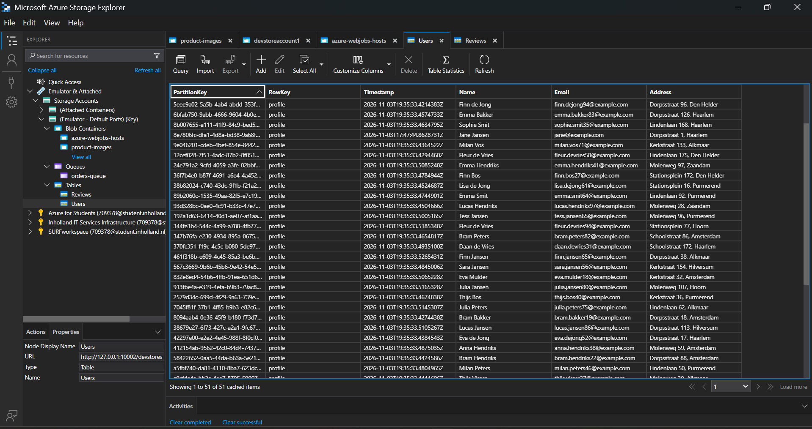
*Users: the user ID as PartitionKey, 'profile' as RowKey*

### 3.6 The order queue

Orders are put in the queue as JSON text. The text is encoded as Base64, because the Azure Functions queue trigger needs that.

The queue showed its value during testing. One order waited in the queue for 22 minutes while the Function was turned off. As soon as the Function started, the order was saved correctly. Nothing gets lost when the back end is busy or down. The pictures below show 15 orders waiting in the queue, the Function handling them, and the empty queue afterwards.

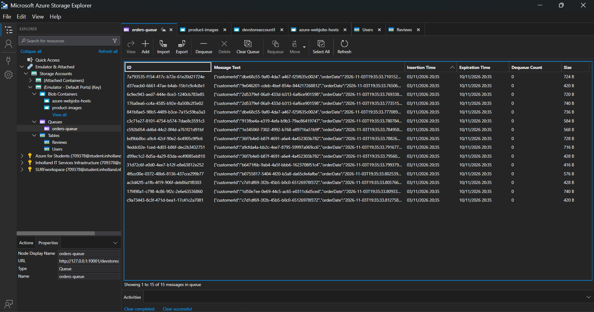
*15 orders waiting in orders-queue*

The Function settings in `host.json` decide how the queue is handled. Up to 16 orders are handled at the same time. In a test, 15 waiting orders were all handled within about 100 milliseconds. If an order fails five times, it is moved to a separate *poison queue*, so someone can look at it. It is not lost, and it does not block other orders.

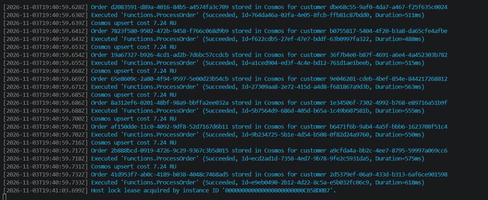
*ProcessOrder handling the orders, 7.24 RU each*

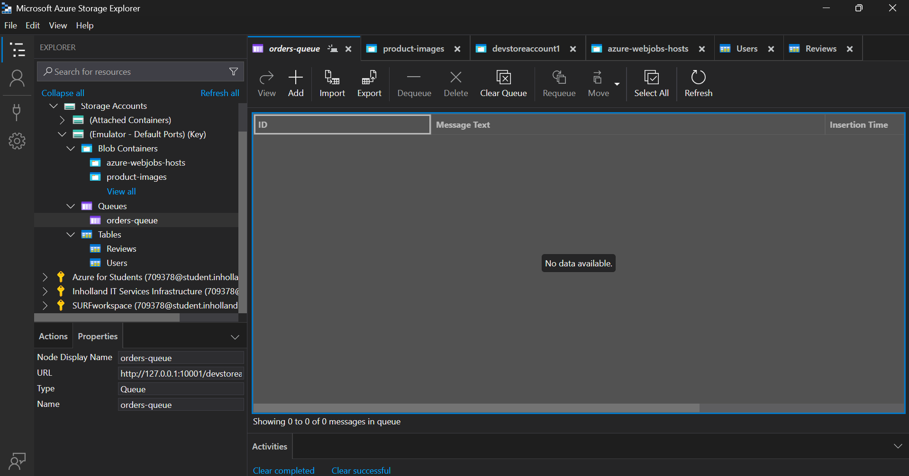
*The queue is empty afterwards*

## 4. The layers (N-tier)

The solution is split into separate projects. Each project has one job, and only uses the layers below it.

**DomainLayer** is the core. It has the business objects (orders, products, reviews and users) and their own rules. For example, an order cannot be shipped twice, or before it was ordered. It does not depend on any other project.

**DataLayer** has all the code that talks to Cosmos DB, SQL, Table Storage, Blob Storage and the queue. The rest of the app only sees its interfaces.

**ApplicationServices** is the business layer. Every action, like placing an order or searching products, is a separate MediatR command or query. Each one has its own handler, which checks the input and applies the business rules.

**WebApi** and **Functions** are the entry points. They have no business logic. They turn the request into a command or query and pass it to MediatR. Errors are turned into clear `400 Bad Request` or `404 Not Found` answers in one place.

There are two Azure Functions. **ProcessOrder** starts when a new message arrives in the queue, and saves the order. **ShipOrder** is called over HTTP when an order is shipped. The API and the Functions use the same layers, so the business logic only exists once. The Functions are connected through the queue, not by calling each other over HTTP. The course slides call that an anti-pattern.

**Tests** has the unit tests. **Seeder** is a small tool that fills the databases with test data and measures the RU costs.

## 5. Loose coupling and testing

Every storage sits behind an **interface**, for example `IWriteOrderRepository` for saving orders, or `IAzureStorageQueue` for the queue. The business logic only knows these interfaces, never the Azure classes behind them. The real classes are plugged in with **dependency injection** when the app starts. This means you could swap a storage for another one without changing the business logic. It also means the business logic can be tested without any database.

That is what the **26 unit tests** do (`dotnet test`, all passing). Every database and the queue are replaced by fake versions made with **Moq** (called *mocks*). So the tests run in a few seconds, without any emulator. The tests show, among other things, that:

- an order uses the price from the database, not from the request;
- wrong orders, unknown customers or products, and orders with too little stock **never reach the queue**;
- an order is saved as Processed when there is stock, and as Rejected when there is not;
- the same message twice is skipped and does not lower the stock again;
- clicking the order button twice with the same order number gives one order;
- shipping an order sends the `OrderShippedEvent`, and an order cannot be shipped twice;
- reviews only accept ratings from 1 to 5, and the shipping-time metric is calculated correctly.

## 6. CQRS

CQRS means that actions that **change** data (*commands*) are kept apart from actions that only **read** data (*queries*). Every command and every query is a separate MediatR request with its own handler:

| Commands (change data) | Queries (read data) |
|---|---|
| Place an order (goes into the **Azure Queue**) | Get one order, get a customer's orders |
| Process an order, ship an order | Get the shipping-time metric |
| Create a product, upload a picture | Get a product, search products |
| Add a review, register a user | Get a product's reviews, get a user |

The two sides are kept apart in a few ways. Commands use *write* repositories, and queries use *read* repositories, so a query can never change data. Each side is also tuned for its job: reading uses the cheaper eventual consistency in Cosmos DB, and skips change tracking in SQL.

Placing an order is the clearest example. The command is accepted and put into the **Azure Queue**. The order can only be read after the Function has saved it, so for a short moment, reading the order says "not found". This is called *eventual consistency*. I chose this on purpose, to keep ordering fast when it is busy.

The controllers and Functions only know MediatR. They do not know which handler runs, or which database it uses. This is the *mediator pattern*. When an order is shipped, an `OrderShippedEvent` is sent through MediatR, and a separate handler reacts to it. Later, new reactions could be added, like sending a "your order is shipped" email, without changing the shipping code.

## 7. Running it on your computer

You need the .NET 10 SDK, Azure Functions Core Tools v4, Azurite, the Azure Cosmos DB Emulator and SQL Server LocalDB.

1. Start Azurite and the Cosmos DB Emulator.
2. Copy `Functions/local.settings.example.json` to `Functions/local.settings.json`.
3. Start the Web API with `dotnet run --project WebApi`. When it starts, it creates the SQL database, the Cosmos container, the tables, the picture container and the queue. It runs on `http://localhost:5294`.
4. In a second terminal, go to the `Functions` folder and run `dotnet run`. The Functions run on `http://localhost:7071`.
5. Open `WebApi/WebApi.http` and send requests 1 to 18 in order. They show registering a user, products, reviews, placing and shipping an order, uploading a picture, the metric, error checks, the stock going down, and clicking twice.
6. Run the tests with `dotnet test`.

For extra test data, `dotnet run --project Seeder` adds 1,000 orders to Cosmos DB and prints the RU costs. `dotnet run --project Seeder -- storage` adds products, 50 users, reviews, and 15 orders waiting in the queue.

All connection strings point to the local emulators. The Cosmos key in the settings is the emulator's public default key, so there are no real passwords in the project.

## 8. Moving it to Azure

This proof of concept runs on local emulators. To move it to Azure, you only change the connection strings, not the code.

The Web API would run on **Azure App Service**. The Functions would run on the **Flex Consumption** plan, which adds more copies by itself when the queue gets busy. Cosmos DB and Azure SQL would be real Azure services, with the same autoscale setting as now.

Pictures, reviews and the queue would share one storage account. A rule would move pictures of old products to the cheaper "Cool" storage. Users would get their own storage account, so the other department only gets access to that. Passwords and keys would be kept in **Azure Key Vault**, and the app would reach them with a **Managed Identity**, so no password is written in any settings file. **Application Insights** would be used to watch the app and its logs.

The project uses the patterns from the course demo repositories (EDAMediatR, WebAppCosmosDBDEMO, TableStorageDEMO, WebApplicationBlobDEMO, FuncInsertQueueDEMO and Cloud1AZFunctionsIntro). I put them together in one solution with separate projects, so the Web API and the Functions share the same business logic.